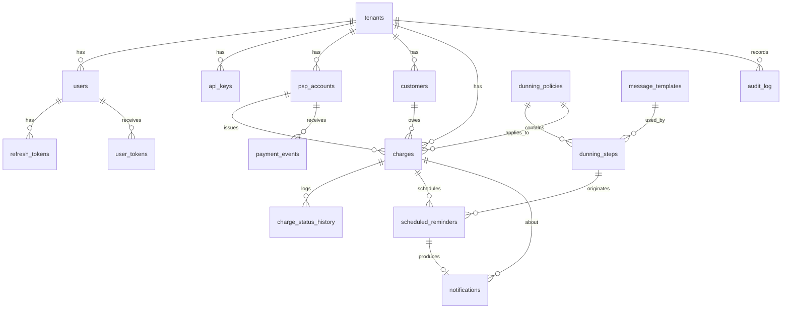

# PinGo — Especificação do Produto e da Arquitetura

**PinGo** é um SaaS multi-tenant de cobrança inteligente via Pix: cadastro de cobranças, Pix gerado sob demanda, régua de lembretes e baixa automática por webhook.

| | |
|---|---|
| **Versão** | 0.4 |
| **Status** | Rascunho em evolução (itens marcados *proposta* e as questões da seção 17 ainda dependem de decisão) |
| **Data** | 2026-10-07 |
| **Autoria** | Gabriel (back-end) e colaborador de front-end |
| **Repositórios** | `pingo-api` (este) e `pingo-web` (front-end) |
| **Documentos relacionados** | `src/main/resources/db/migration/V1__init_schema.sql` (schema), `docs/api/openapi.yaml` (contrato, a criar na Fase 1), `docs/security.md` (modelo de ameaças, a criar na Fase 1) |
| **Convenções** | Texto da spec em português; código, tabelas, classes e endpoints em inglês. Requisitos: `RF-nn` (funcionais), `RN-nn` (regras de negócio), `D-nn` (decisões), `Q-nn` (questões em aberto) |

> **Escopo e limites.** Projeto de portfólio: o Pix roda no modo de teste do Stripe e e-mail e SMS são simulados. O desenho segue padrões de produto real (isolamento entre tenants, idempotência, segurança verificável), e o que for demonstrado na AWS é classificado por **níveis de prova** (seção 10.8).

## Índice

1. [Contexto e problema](#1-contexto-e-problema)
2. [Objetivos e não-objetivos](#2-objetivos-e-não-objetivos)
3. [Atores](#3-atores)
4. [Glossário](#4-glossário)
5. [Decisões tomadas](#5-decisões-tomadas)
6. [Requisitos funcionais](#6-requisitos-funcionais)
7. [Regras de negócio](#7-regras-de-negócio)
8. [Máquina de estados da cobrança](#8-máquina-de-estados-da-cobrança)
9. [Requisitos não funcionais](#9-requisitos-não-funcionais)
10. [Arquitetura](#10-arquitetura)
11. [Modelo de dados](#11-modelo-de-dados)
12. [Contratos de API (resumo)](#12-contratos-de-api-resumo)
13. [Segurança](#13-segurança)
14. [Critérios de aceite (Gherkin)](#14-critérios-de-aceite-gherkin)
15. [Plano de fases](#15-plano-de-fases)
16. [Riscos](#16-riscos)
17. [Questões em aberto](#17-questões-em-aberto)
18. [Histórico de mudanças](#18-histórico-de-mudanças)

---

## 1. Contexto e problema

Pequenos negócios (escritórios, academias, escolas, prestadores de serviço, agências) cobram clientes recorrentes ou avulsos e perdem tempo e dinheiro com inadimplência. O acompanhamento costuma ser manual: planilha, mensagem avulsa no WhatsApp, esquecimento de quem já pagou.

O produto é um SaaS multi-tenant que:
1. registra cobranças e gera o Pix através de um PSP;
2. dispara lembretes automáticos conforme uma **régua de cobrança** configurável (antes e depois do vencimento);
3. detecta o pagamento por webhook e interrompe os lembretes sozinho;
4. mostra ao lojista o que foi recebido, o que está em atraso e quanto foi recuperado.

## 2. Objetivos e não-objetivos

### Objetivos (MVP)
- Cobrança Pix ponta a ponta no **modo de teste do Stripe** (criação → lembretes → Pix sob demanda → baixa automática).
- Régua configurável por tenant, com canais **e-mail e SMS**.
- Processamento assíncrono robusto: idempotência, retry com backoff, DLQ, outbox, worker retomável.
- Webhook autenticado por assinatura HMAC (Stripe-Signature), com proteção contra replay.
- Rate limit na entrada (por tenant e por IP) e na saída (por canal/provedor).
- Isolamento rigoroso entre tenants, em quatro camadas (claim do JWT, filtro de query, FKs compostas e Row Level Security).
- Segurança verificável: projeto guiado pelo **OWASP ASVS nível 2** e por um modelo de ameaças curto (`docs/security.md`), com cenários de segurança automatizados no CI (seção 13).
- Banco versionado com Flyway, rodando igual em local, CI e produção.
- **Custo fixo mínimo**: o MVP roda em `docker compose`, num host gratuito ou de ~€5/mês. A AWS é *documentada com níveis de prova* e demonstrada em janelas curtas (seção 10.8).
- Contrato da API publicado em OpenAPI, consumido pelo repositório do front.

### Não-objetivos (fora do MVP)
- Boleto, cartão, parcelamento, assinatura/recorrência automática.
- Multa e juros por atraso.
- Negativação (Serasa/SPC), cobrança por voz, WhatsApp (entra como evolução).
- Split de pagamento, conciliação contábil, emissão de nota fiscal.
- Multi-moeda (somente BRL).
- App mobile.
- Dinheiro real: o MVP roda só em modo de teste. Operar em produção exigiria ativar conta e passar pelo KYC do Stripe.
- Operar 24/7 na AWS (estimativa de ~US$ 60–70/mês, ver 10.7).

## 3. Atores

| Ator | Descrição |
|---|---|
| **Admin do tenant** | Dono/gestor da empresa. Configura PSP, usuários, API keys, réguas. |
| **Operador do tenant** | Funcionário que cadastra clientes e cobranças e acompanha status. |
| **Sistema integrado** | Sistema do tenant que cria cobranças via API key. |
| **Devedor (pagador)** | Cliente final. **Não tem conta**: recebe link público com token. |
| **PSP** | Provedor de pagamento (Stripe no MVP). Emite o Pix e envia webhooks. |

## 4. Glossário

- **Tenant**: empresa cliente do SaaS. Todos os dados pertencem a um tenant.
- **Charge (cobrança)**: valor a receber de um cliente, com vencimento. O Pix é gerado sob demanda.
- **Régua (dunning policy)**: conjunto de passos de lembrete relativos ao vencimento.
- **Passo (dunning step)**: "N dias antes/depois do vencimento, enviar template T pelo canal C".
- **Lembrete (scheduled reminder)**: instância agendada de um passo para uma cobrança específica.
- **Notificação**: envio efetivo (e-mail/SMS) de um lembrete.
- **PSP**: Payment Service Provider.
- **Inbox de eventos**: tabela que guarda todo webhook recebido, base da idempotência.
- **Outbox**: tabela de eventos de domínio gravados na mesma transação do dado, publicados depois.
- **Pix attempt**: contador de gerações de Pix de uma cobrança; compõe a chave de idempotência enviada ao PSP.
- **Catch-up**: processamento das pendências vencidas quando o worker volta de uma parada.
- **Nível de prova**: grau de evidência de que um serviço AWS funcionaria em produção (seção 10.8).
- **Blind index**: HMAC de um dado sensível (ex.: CPF) guardado ao lado do dado criptografado, para permitir busca e unicidade sem expor o valor.
- **RLS (Row Level Security)**: regra do Postgres que filtra linhas por tenant dentro do próprio banco.
- **Escopo `system`**: modo explícito de transação, usado por login, webhook, página pública e workers, que precisam enxergar mais de um tenant.

## 5. Decisões tomadas

| # | Decisão | Motivo |
|---|---|---|
| D1 | PSP inicial: **Stripe** (modo de teste), atrás da interface `PaymentProvider`. **Asaas** entra como segundo adapter (Fase 7) | Conta e modo de teste gratuitos, documentação e SDK Java fortes, "Simulate scan" para o Pix, assinatura HMAC nativa, conhecimento transferível para vagas internacionais. |
| D2 | Canais do MVP: **e-mail + SMS** | Exercita rate limit de saída e fallback entre canais. WhatsApp fica para depois. |
| D3 | Multi-tenancy com **`tenant_id` em cada tabela** (schema único) | Mais simples de operar e migrar. Reforçado com FKs compostas no banco. |
| D4 | Devedor sem conta, acesso por **link público com token** | Menos fricção, menos superfície de ataque. |
| D5 | **Monolito modular** em Spring Boot, com dois perfis de execução: `api` e `worker` | Time pequeno. Mesma base de código, escala separada. Sem microsserviços prematuros. |
| D6 | Valores em **centavos** (`bigint`), moeda BRL | Evita erro de ponto flutuante. |
| D7 | MVP: **uma conta Stripe da plataforma em modo de teste**, compartilhada pelos tenants de demonstração (cada tenant tem seu `psp_accounts`, apontando para a mesma credencial). Evolução: **Stripe Connect**, uma conta conectada por tenant (`external_account_id`) | Evita onboarding/KYC de tenants no portfólio, sem fechar a porta para o modelo SaaS real. |
| D8 | Régua é **materializada (snapshot)** na criação da cobrança | Editar a régua depois não altera cobranças já criadas. Resultado previsível e auditável. |
| D9 | Estados da cobrança: `PENDING`, `OVERDUE`, `PAID`, `CANCELED`. "Enviada" **não** é estado | Envio é rastreado em `notifications`, não polui a máquina de estados. |
| D10 | JWT **HS256** (access 15 min) + refresh token com rotação. Algoritmo **fixado** no decoder (rejeita `none` e qualquer outro). Valida `iss`, `aud`, `exp` e `nbf`. `kid` no header permite rotacionar o segredo. Segredo com no mínimo 256 bits, obtido pelo `SecretResolver`, nunca no repositório | A API assina e verifica (monolito), então a chave simétrica basta e simplifica. Validação via `oauth2-resource-server` com `NimbusJwtDecoder.withSecretKey`. Se outro serviço precisar verificar tokens, voltar para RS256 + JWKS. Vazamento do segredo permite forjar tokens, por isso o cuidado com o segredo. |
| D11 | Webhook do Stripe validado pelo header **`Stripe-Signature`**: HMAC-SHA256 sobre `timestamp.corpo`, segredo por endpoint, tolerância de timestamp (5 min), comparação em tempo constante, **sobre o corpo bruto**. Implementação manual (aprendizado), conferida nos testes contra `Webhook.constructEvent` do SDK | Cada PSP define seu mecanismo. HMAC com timestamp também protege contra replay. |
| D12 | Entrega **at-least-once** com consumidores idempotentes | Padrão realista para filas e webhooks. |
| D13 | **Pix gerado sob demanda**: a cobrança nasce sem Pix e ele é criado quando o devedor abre o link público (ou na regeneração) | O Stripe não tem cobrança Pix com data de vencimento: o Pix expira por tempo. Assim o e-mail nunca leva um QR Code vencido. |
| D14 | **Flyway** para migrations; Hibernate com `ddl-auto=validate` | Schema versionado no Git, reproduzível em Testcontainers, CI e produção. A migration é parte da spec. |
| D15 | **Hospedagem compose-first**: o sistema roda igual em qualquer host que rode Docker. Host de demo decidido após a Fase 4 (gratuito ou VPS de ~€5). AWS real só em janelas curtas | Custo de portfólio próximo de zero, sem refazer nada ao trocar de host. Detalhes em 10.7. |
| D16 | **Dois repositórios**: `pingo-api` (backend, spec, infra, contrato) e `pingo-web` (front). Contrato OpenAPI primeiro, versionado por tag | CI e deploy independentes; o front trabalha em paralelo com mocks. Detalhes em 10.6. |
| D17 | **Package by feature**; portas (estilo hexagonal) **somente** onde há troca de implementação: PSP, fila, scheduler, notificação, segredos | Evita burocracia de camadas em módulos que não vão trocar de tecnologia. |
| D18 | **Worker retomável** (catch-up), descartando lembretes muito atrasados (RN-16) | Hosts baratos ou gratuitos podem parar o worker. Nenhum lembrete se perde, e nenhum "faltam 3 dias" sai depois do vencimento. |
| D19 | Adapters AWS testados contra **LocalStack Hobby** (auth token, uso não comercial); infra validada com `terraform test` + `mock_provider`. **Floci** fica como alternativa a avaliar | Prova que o adapter fala a API da AWS sem gastar nada. |
| D20 | Senhas com **Argon2id** via `DelegatingPasswordEncoder` do Spring Security (parâmetros iniciais da OWASP: 19 MiB de memória, 2 iterações, paralelismo 1; ajustar para ~100–500 ms no host). Hash com prefixo do algoritmo, para migrar no futuro sem quebrar senhas | Resiste melhor a ataque com GPU que o BCrypt (consome memória). Exige `bcprov-jdk18on`. |
| D21 | **CPF/CNPJ criptografado na aplicação** (AES-256-GCM) com **blind index** (HMAC-SHA256, chave separada) para unicidade e busca; coluna `key_version` para rotação. Chaves fora do banco, via `SecretResolver`. E-mail e telefone ficam em texto puro | Hash não serve para dado que precisa ser lido de volta; criptografia sim. E-mail e telefone são necessários para busca e envio, e já ficam protegidos por RLS, disco/backup criptografado e logs sem PII. A decisão é consciente e documentada em `docs/security.md`. |
| D22 | **Refresh token em cookie `HttpOnly; Secure; SameSite=Strict; Path=/api/v1/auth`**. O access token fica só em memória no front; ao recarregar a página, o front chama `/auth/refresh`. Front e API precisam estar no **mesmo site** (Q15) | JavaScript (XSS) não consegue ler o refresh token. Em desenvolvimento local, `localhost:5173` e `localhost:8080` contam como o mesmo site. CORS com origem exata e `allowCredentials`. |
| D23 | **Row Level Security** do Postgres como 4ª camada de isolamento. A aplicação define por transação `app.tenant_id` (requisições normais) ou `app.scope = 'system'` (login, webhook, página pública, workers). A aplicação conecta com role sem superusuário (`pingo_app`) | Se um filtro de query for esquecido, o banco ainda barra. Superusuários ignoram RLS, por isso a role dedicada. |
| D24 | Padrão de segurança: **OWASP ASVS nível 2** + modelo de ameaças STRIDE curto em `docs/security.md`, ligando cada ameaça a RF, RN ou cenário Gherkin | Dá um critério verificável e defensável no README. |

## 6. Requisitos funcionais

### 6.1 Autenticação, tenants e acesso
- **RF-01** Cadastro de tenant com criação do primeiro usuário `ADMIN`.
- **RF-02** Login por e-mail e senha. Devolve o access token JWT (HS256, 15 min) no corpo e define o refresh token em cookie `HttpOnly` (D22). Rotação a cada uso, com detecção de reuso por família. Regras de bloqueio e erro em RN-17.
- **RF-03** Perfis: `ADMIN` (tudo, incluindo usuários, API keys e PSP) e `OPERATOR` (clientes, cobranças, notificações; leitura de réguas e templates).
- **RF-04** API keys por tenant: criar, listar (apenas prefixo), revogar. A chave completa é exibida uma única vez.
- **RF-05** Configuração da conta PSP do tenant: provider, ambiente (teste/produção), referência da credencial e do segredo do webhook, e `external_account_id` quando houver Connect. Aceita um segredo de webhook **anterior** durante a rotação (RN-21).
- **RF-34** Reset de senha: `POST /auth/password/forgot` (sempre `202`) e `POST /auth/password/reset` (token de uso único). Regras em RN-18. O e-mail passa pelo `NotificationSender` (Mailpit localmente).
- **RF-35** Verificação de e-mail no cadastro, com o mesmo mecanismo de token (`POST /auth/email/verify`). No MVP o usuário não verificado consegue entrar; a obrigatoriedade fica em aberto (Q16).
- **RF-36** Trilha de auditoria por tenant (`audit_log`, somente inserção): criação e revogação de API key, mudança de usuário e perfil, alteração de PSP e de régua, cancelamento de cobrança, reset de senha concluído. Consulta por `GET /audit-log` (ADMIN).

### 6.2 Clientes
- **RF-06** CRUD de clientes com soft delete. Pelo menos um contato (e-mail ou telefone) é obrigatório.
- **RF-07** Opt-out por canal (e-mail, SMS), ativável por usuário ou pelo próprio devedor via link de descadastro.

### 6.3 Cobranças
- **RF-08** Criar cobrança: cliente, valor, vencimento, descrição, régua (opcional, senão usa a padrão), `external_reference` (opcional). Suporta header `Idempotency-Key`. A criação **não** chama o PSP (D13) e devolve o `pay_link`.
- **RF-09** **Gerar o Pix sob demanda**: na primeira abertura do link público, ou quando o Pix anterior expirou, cria no PSP o pagamento Pix do valor da cobrança, com o `charge_id` nos metadados e com chave de idempotência `charge:{id}:pix:{pix_attempt}`. Guarda o id do pagamento, o copia-e-cola, a imagem do QR e a expiração. Pix ainda válido é reaproveitado. Se o PSP falhar, a chamada pública responde `502` e a cobrança não muda de estado.
- **RF-10** Consultar e listar cobranças com filtros (status, cliente, faixa de vencimento) e paginação.
- **RF-11** Cancelar cobrança em `PENDING` ou `OVERDUE`: cancela o pagamento Pix em aberto no PSP (se houver) e os lembretes pendentes.
- **RF-12** Regenerar o Pix (cobrança `PENDING` ou `OVERDUE`): incrementa `pix_attempt`, cria novo pagamento e cancela o anterior no PSP (melhor esforço).
- **RF-13** Histórico de transições de status por cobrança.

### 6.4 Régua e templates
- **RF-14** CRUD de réguas com passos (`offset_days`, canal, template). Cada tenant tem no máximo uma régua padrão.
- **RF-15** CRUD de templates por canal, com variáveis: `{{customer_name}}`, `{{amount}}`, `{{due_date}}`, `{{pay_link}}`, `{{tenant_name}}`. O `pay_link` leva à página que gera o Pix na hora.
- **RF-16** Na criação da cobrança, materializar os lembretes a partir da régua. Passos cujo horário já passou são marcados `SKIPPED`.
- **RF-17** Ao pagar ou cancelar a cobrança, cancelar todos os lembretes `SCHEDULED`.

### 6.5 Notificações
- **RF-18** Disparar o lembrete no horário agendado, respeitando a janela de envio do tenant. Fora da janela, adia para a abertura seguinte.
- **RF-19** Envio por e-mail e por SMS atrás de interfaces (`NotificationSender`), com implementação mock local.
- **RF-20** Retry com backoff exponencial e DLQ após o limite de tentativas. Status sempre visível.
- **RF-21** Antes de enviar, reconferir: cobrança ainda aberta, cliente sem opt-out, contato existente. Caso contrário, `SKIPPED` com motivo.
- **RF-22** Listar notificações por cobrança. O texto renderizado de cada notificação é visível na aplicação, o que serve de demonstração mesmo com e-mail e SMS simulados.

### 6.6 Webhooks do PSP
- **RF-23** Endpoint por conta PSP: `POST /webhooks/stripe/{pspAccountId}`. Valida a assinatura sobre o corpo bruto, grava o evento na inbox e responde `200` rapidamente.
- **RF-24** Idempotência por `(psp_account_id, provider_event_id)`, usando o `id` do evento do Stripe (`evt_...`). Evento repetido responde `200` sem reprocessar.
- **RF-25** Eventos tratados no MVP: pagamento concluído (`payment_intent.succeeded`), pagamento cancelado ou falho (apenas registra) e estorno (registra e alerta). Mapeamento exato no adapter, conforme a documentação. A cobrança é localizada por `metadata.charge_id` (preferencial) ou pelo id do pagamento.
- **RF-26** Processamento assíncrono do evento (fila `payment-events`), tolerante a ordem trocada.

### 6.7 Página pública de pagamento
- **RF-27** Dois endpoints sem login, com rate limit por IP: `GET /public/charges/{token}` (valor, vencimento, nome do tenant e status) e `POST /public/charges/{token}/pix` (garante um Pix válido e devolve QR Code e copia-e-cola, conforme RF-09).

### 6.8 Dashboard
- **RF-28** Métricas por tenant e período: total cobrado, recebido, em atraso, taxa de recuperação, aging (0–7, 8–30, 30+ dias).

### 6.9 Evoluções (fora do MVP, já previstas no desenho)
- **RF-29** Importação CSV de clientes e cobranças (assíncrona, via S3/MinIO, com relatório de erros por linha).
- **RF-30** Webhooks de saída para o sistema do tenant (`charge.paid`, `charge.overdue`), assinados com o mesmo esquema HMAC-SHA256 com timestamp.
- **RF-31** Reconciliação diária com o PSP (fonte da verdade) para cobranças sem evento.
- **RF-32** Adapter Asaas, Stripe Connect (uma conta conectada por tenant) e canal WhatsApp.
- **RF-33** Cota mensal de SMS por tenant (proposta, ver Q2).

## 7. Regras de negócio

- **RN-01** Valor sempre em centavos, maior que zero. Moeda BRL.
- **RN-02** `due_date` é uma data no fuso do tenant (padrão `America/Sao_Paulo`). A cobrança vira `OVERDUE` quando `due_date < hoje` no fuso do tenant.
- **RN-03** `PAID` e `CANCELED` são estados terminais.
- **RN-04** Pagamento recebido para cobrança `CANCELED`: o evento é registrado como `IGNORED` com motivo e o tenant é alertado (possível estorno manual).
- **RN-05** Pagamento com valor menor que o da cobrança não dá baixa: evento `IGNORED` com motivo e alerta ao tenant.
- **RN-06** Pagamento de cobrança `OVERDUE` é aceito e leva a `PAID`.
- **RN-07** Janela de envio padrão: 08h–20h no fuso do tenant (configurável).
- **RN-08** Todo e-mail contém link de descadastro. Opt-out vale para lembretes futuros.
- **RN-09** Templates padrão com tom respeitoso: sem ameaça, sem exposição do devedor. O CDC (art. 42) veda constrangimento na cobrança de dívidas.
- **RN-10** Máximo de 5 tentativas de envio por notificação, depois DLQ.
- **RN-11** Toda consulta é filtrada por `tenant_id`. Acesso a recurso de outro tenant responde `404` (nunca `403`, para não revelar existência).
- **RN-12** `external_reference` é único por tenant.
- **RN-13** Cada lembrete gera no máximo uma notificação.
- **RN-14** Edição de régua não altera cobranças existentes (D8).
- **RN-15** A expiração do Pix **não** muda o status da cobrança. Só `due_date` define `OVERDUE`. Pix expirado é regenerado sob demanda.
- **RN-16** *(proposta)* Catch-up: ao retomar, lembrete com `scheduled_for` atrasado em até 24 h (configurável) ainda é enviado; acima disso fica `SKIPPED` com motivo `stale`, sem envio.
- **RN-17** Login: mensagem de erro única para e-mail inexistente e senha errada, com tempo de resposta semelhante. Bloqueio progressivo por conta após 5 falhas seguidas (1 min, dobrando até 15 min), além do rate limit por IP. Senha com no mínimo 12 caracteres.
- **RN-18** Reset de senha: `forgot` responde sempre `202`. Token de 32 bytes aleatórios, guardado só como SHA-256, válido por 30 min e de uso único. Ao concluir: troca a senha, invalida os outros tokens do usuário e **revoga todos os refresh tokens**. Rate limit por IP e por e-mail.
- **RN-19** Templates: aceitam somente as 5 variáveis fixas (`customer_name`, `amount`, `due_date`, `pay_link`, `tenant_name`), com substituição própria e **sem motor de expressão**. Variável desconhecida é rejeitada ao salvar (`422`). No e-mail em HTML, valores são escapados; `\r` e `\n` são removidos de assunto e cabeçalhos; no SMS, caracteres de controle são removidos e o tamanho é limitado.
- **RN-20** `Idempotency-Key`: escopo por tenant, vinculada ao hash do corpo (mesma chave com corpo diferente responde `422`) e expira em 24 h.
- **RN-21** Webhook: aceita o segredo atual e o anterior (rotação); corpo máximo de 256 KB (`413`); `livemode` do evento deve coincidir com o `environment` da conta (`SANDBOX` ↔ `false`), senão o evento é rejeitado e registrado; antes de dar baixa, confere valor e moeda contra a cobrança (divergência: `IGNORED` com motivo e alerta, ver RN-05).
- **RN-22** Página pública: token de 256 bits; depois de `PAID` ou `CANCELED` a página mostra só o status e não gera Pix; token inexistente responde igual a cobrança de outro tenant.

## 8. Máquina de estados da cobrança

```
            webhook: pago                 webhook: pago
 PENDING ─────────────────► PAID ◄───────────────────── OVERDUE
    │                                                      ▲
    │         job: due_date < hoje (fuso do tenant)        │
    ├──────────────────────────────────────────────────────┘
    │ cancelar                                  cancelar
    └──────────────► CANCELED ◄─────────────────────────────┘
```

| De | Para | Gatilho | Efeitos |
|---|---|---|---|
| — | `PENDING` | Criação | Lembretes materializados, evento `ChargeCreated` (sem Pix, ver D13) |
| `PENDING` | `OVERDUE` | Job diário | Evento `ChargeOverdue` |
| `PENDING`/`OVERDUE` | `PAID` | Webhook de pagamento | Cancela lembretes, evento `ChargePaid` |
| `PENDING`/`OVERDUE` | `CANCELED` | Ação do usuário/API | Cancela o Pix no PSP (se houver), cancela lembretes |

Transições inválidas retornam `409`. Toda transição grava linha em `charge_status_history`. Concorrência controlada por `version` (lock otimista) ou `SELECT ... FOR UPDATE` no consumidor do webhook.

## 9. Requisitos não funcionais

- **Segurança**: alvo OWASP ASVS nível 2 (seção 13); senhas com Argon2id (D20); JWT HS256 com algoritmo fixado (D10); CPF/CNPJ criptografado (D21); RLS (D23); segredos fora do banco (Secrets Manager/SSM em produção; env var local); nunca logar PII, chaves, tokens ou payload completo de pagamento.
- **Performance**: webhook p95 < 300 ms (valida, grava, enfileira). API p95 < 500 ms.
- **Confiabilidade**: at-least-once, consumidores idempotentes, outbox para publicar eventos, retry com backoff, DLQ monitorada.
- **Retomável**: após reinício ou suspensão do host, o worker processa as pendências sem perder lembretes (catch-up, RN-16). O poller sempre busca `scheduled_for <= agora`, e o Stripe reenvia webhooks não confirmados.
- **Rate limit de entrada**: API autenticada 120 req/min por tenant (configurável em `tenants.rate_limit_per_minute`), resposta `429` com `Retry-After`. Endpoint público: 30 req/min por IP; `POST /public/charges/{token}/pix` com limite mais baixo (10 req/min por IP e por token), porque cria objetos no PSP. Implementação com Bucket4j + Redis.
- **Rate limit de saída**: token bucket por canal/provedor no worker de notificações, respeitando a cota do SES e do provedor de SMS. Chamadas ao Stripe também com timeout, retry limitado e circuit breaker.
- **Observabilidade**: logs JSON com `correlationId` e `tenantId`; métricas via Micrometer (profundidade de fila, enviados/falhos, duplicados detectados, latência do webhook, falhas de assinatura, tempo de geração de Pix, atraso do worker). Prometheus/Grafana local, CloudWatch na AWS.
- **LGPD**: dados mínimos do devedor; opt-out; anonimização de cliente excluído; o tenant é o controlador dos dados.
- **Testabilidade**: Testcontainers (Postgres, Redis, RabbitMQ, LocalStack com auth token), WireMock para o Stripe, testes de contrato do webhook, execução de todas as migrations Flyway do zero, `terraform test` com `mock_provider`.
- **Portabilidade**: portas `PaymentProvider`, `MessagePublisher`, `ReminderScheduler`, `NotificationSender`, `SecretResolver`, com adapters locais e AWS.
- **Custo**: o ambiente de demonstração roda com custo fixo próximo de zero (D15, seção 10.7).

## 10. Arquitetura

### 10.1 Visão geral
Monolito modular Spring Boot (Java 21), **package by feature** (`tenant`, `auth`, `customer`, `charge`, `payment`, `dunning`, `notification`, `scheduling`, `messaging`, `dashboard`, `shared`). Dois perfis de execução:
- **`api`**: controllers REST, webhook, página pública.
- **`worker`**: consumidores de fila, publicador de outbox, scheduler/poller, job de vencimento.

Perfis de ambiente: `local` (RabbitMQ, poller, Mailpit), `localstack` (adapters AWS contra o emulador) e `aws` (serviços reais).

### 10.2 Onde cada peça roda

| Responsabilidade | Roda hoje (grátis) | AWS em produção | Prova |
|---|---|---|---|
| Banco | PostgreSQL (container ou Neon) | RDS PostgreSQL | 3 → 4 |
| Migrations | Flyway no startup | Flyway no startup ou tarefa dedicada | — |
| Fila | RabbitMQ (container ou CloudAMQP free) | SQS + DLQ | 2 |
| Agendamento de lembretes | Poller no banco (`FOR UPDATE SKIP LOCKED`) | EventBridge Scheduler (one-time por lembrete) | 2 (criação), 4 (disparo) |
| E-mail | Mailpit ou mock, texto visível na UI | SES | 2 → 4 |
| SMS | Mock | SNS SMS ou provedor (decidir, Q2) | — |
| PSP | Stripe em modo de teste + Stripe CLI (`stripe listen --forward-to`) | Stripe (produção exigiria ativação) | — |
| Arquivos (CSV, evolução) | MinIO | S3 | — |
| Rate limit/cache | Redis (container ou Upstash free) | ElastiCache | 3 |
| Segredos | Variáveis de ambiente | Secrets Manager / SSM | 2 |
| Execução | Docker Compose em host barato/gratuito | ECS Fargate + ALB | 3 → 4 |
| Infra como código | Terraform no repositório | Terraform | 3 |
| Ingress do webhook | Controller Spring | Controller Spring (evolução: API Gateway → Lambda → SQS) | só documentado |

A coluna **Prova** usa os níveis da seção 10.8.

### 10.3 Fluxos

**A. Criar cobrança**
1. API autentica (JWT ou API key) e aplica rate limit por tenant.
2. Verifica `Idempotency-Key` (resposta salva é reaproveitada se o hash da requisição bater; hash diferente com a mesma chave retorna `422`).
3. Em uma transação: insere `charges` (sem Pix), `scheduled_reminders`, `charge_status_history` e `outbox_events`.
4. Responde `201` com o `pay_link`. Nenhuma chamada ao PSP acontece aqui.

**B. Webhook de pagamento**
1. `POST /webhooks/stripe/{pspAccountId}` lê o corpo bruto e valida o `Stripe-Signature` (HMAC-SHA256 sobre `timestamp.corpo`, tolerância de timestamp, comparação em tempo constante).
2. `INSERT ... ON CONFLICT DO NOTHING` em `payment_events`. Se já existia, responde `200` e encerra.
3. Publica mensagem em `payment-events` e responde `200`.
4. Consumidor carrega o evento, localiza a cobrança (`metadata.charge_id`), trava, valida regras (RN-04, RN-05), aplica a transição, grava histórico, cancela lembretes, grava outbox `ChargePaid` e marca o evento `PROCESSED`.

**C. Lembrete**
1. Scheduler (poller local / EventBridge) publica `reminder-due` com o `reminder_id`.
2. Worker reconfere cobrança, opt-out, janela de envio e idade do lembrete (RN-16). Fora da janela: reagenda. Lembrete velho demais: `SKIPPED` (`stale`).
3. Aplica rate limit de saída do canal, renderiza o template e grava `notifications` (snapshot do texto).
4. Envia. Sucesso: `SENT`. Falha: retry com backoff (1 min, 5 min, 30 min, 2 h, 6 h). Esgotou: `DEAD` e mensagem na DLQ.

**D. Vencimento**
Job diário (e a cada hora, para cobrir fusos) marca `PENDING → OVERDUE` onde `due_date < hoje` no fuso de cada tenant.

**E. Outbox**
Publicador do worker lê `outbox_events` não publicados (`FOR UPDATE SKIP LOCKED`), publica na fila e marca `published_at`. Garante que o evento só sai se a transação commitou.

**F. Pix sob demanda**
1. O devedor abre o `pay_link`; a página chama `GET /public/charges/{token}` e depois `POST /public/charges/{token}/pix` (rate limit por IP).
2. Se a cobrança não está `PENDING`/`OVERDUE`, responde `409`. Se já existe Pix com `pix_expires_at` no futuro, devolve o existente.
3. Senão, chama `PaymentProvider.createPixPayment` com `charge_id` nos metadados e chave de idempotência `charge:{id}:pix:{pix_attempt}`. Duas aberturas simultâneas recebem o mesmo pagamento do PSP.
4. Atualiza a cobrança (`psp_charge_id`, `pix_*`, `pix_attempt`) com lock otimista. Em caso de conflito, relê e devolve o resultado já gravado.

### 10.4 Filas

| Fila | Produtor | Consumidor | DLQ |
|---|---|---|---|
| `payment-events` | Webhook controller | Processador de pagamento | sim |
| `reminder-due` | Scheduler | Preparador de notificação | sim |
| `notification-send` | Preparador | Enviador (e-mail/SMS) | sim |
| `domain-events` | Publicador de outbox | Dashboard/futuros webhooks de saída | sim |

### 10.5 Mensageria: fluxo e regras

```
 API ──(mesma transação)──► outbox_events ──► [OutboxPublisher] ──► domain-events

 Stripe ──webhook──► [WebhookController]
                      1. valida Stripe-Signature (HMAC, corpo bruto)
                      2. INSERT payment_events ON CONFLICT DO NOTHING
                      3. publica ──► payment-events ──► [PaymentEventProcessor]
                      [InboxSweeper] re-publica eventos RECEIVED parados há mais de 1 min

 [ReminderScheduler] (poller no banco / EventBridge na AWS)
        └──► reminder-due ──► [ReminderPreparation] ──► INSERT notifications
                                └──► notification-send ──► [NotificationDispatch]
                                      rate limit do canal → e-mail/SMS
                                      ok: SENT · falha: FAILED, attempts++, next_attempt_at
                                      [RetryPoller] re-publica quando next_attempt_at <= agora
                                      5ª falha: DEAD + mensagem em notification-send.dlq
```

1. **A mensagem carrega só IDs** (`messageId`, `type`, `tenantId`, `aggregateId`, `correlationId`, `occurredAt`). O consumidor relê o banco e nunca trabalha com dado velho.
2. **Backoff no banco, não no broker.** `attempts` e `next_attempt_at` já estão no schema, e um poller re-publica na hora certa. Funciona igual em RabbitMQ e SQS, que têm limites diferentes de atraso (o SQS atrasa no máximo 15 min por mensagem, e a spec pede retries de até 6 h).
3. **DLQ em dois níveis.** Falha de negócio (provedor fora do ar) vira `FAILED` e depois `DEAD` pelo banco. Falha técnica (mensagem que não deserializa, bug) vai para a DLQ do broker depois de poucas entregas e é reprocessada manualmente.
4. **Todo consumidor é idempotente.** O banco garante: `payment_events(psp_account_id, provider_event_id)` único e `notifications(reminder_id)` único.
5. **Sem garantia de ordem.** A máquina de estados da cobrança decide se a transição é válida; no SQS, fila standard e não FIFO.
6. **Nada de publicar "por fora" da transação.** Domínio vai por outbox. No webhook, a inbox mais o sweeper cobrem a falha entre gravar e publicar.
7. **Listeners finos.** `RabbitListeners` e `SqsListeners` só desserializam e chamam o caso de uso; a lógica não depende do broker.
8. **`reminder-due` e `notification-send` são filas separadas**, porque a segunda recebe o rate limit por canal e o retry, e pode escalar sozinha.

### 10.6 Repositórios e estrutura do projeto

**Dois repositórios** (D16):

```
pingo-api/   (Spring Boot, spec, infra, contrato)      pingo-web/   (front)
        └──► docs/api/openapi.yaml ──(publica, com tag)──► openapi/openapi.yaml
                                                           └─► cliente TS + mocks MSW gerados
```

**Contrato primeiro**
1. A spec define um requisito (por exemplo, RF-09).
2. O contrato é atualizado em `docs/api/openapi.yaml` num PR do backend e recebe uma tag (`contract-v0.3.0`).
3. O front sincroniza o contrato naquela tag, gera o cliente TypeScript e os mocks do MSW, e desenvolve a tela antes do backend existir.
4. O CI do backend gera o OpenAPI a partir do código (springdoc) e **quebra o build se divergir** do `openapi.yaml`.
5. Mudança incompatível: adiciona o campo novo, o front se adapta e só depois remove o antigo (expand/contract). Quebra definitiva vira `/api/v2`.

**`pingo-api`**

```
pingo-api/
├── README.md, pom.xml, docker-compose.yml, .env.example
├── .github/workflows/ci.yml        # build, testes, Flyway do zero, contrato, terraform test, gitleaks, CodeQL, Trivy
├── docs/
│   ├── spec.md
│   ├── api/openapi.yaml            # O CONTRATO
│   ├── aws.md                      # onde e por quê (seção 10.8)
│   ├── security.md                 # modelo de ameaças (STRIDE) e checklist ASVS L2
│   ├── adr/                        # D1…D24 em ADRs curtos
│   └── phases/                     # spec e tasks de cada fase (SDD)
├── infra/terraform/
│   ├── modules/                    # messaging · scheduling · email · secrets · data · compute
│   ├── envs/localstack/            # aplica só o que o emulador suporta
│   ├── envs/aws-demo/              # stack completa, usada só em janelas curtas
│   └── tests/                      # *.tftest.hcl com mock_provider
└── src/
    ├── main/java/br/com/pingo/
    │   ├── shared/                 # tenant, security, ratelimit, idempotency, erros
    │   ├── tenant/ auth/ customer/ dashboard/
    │   ├── charge/                 # cobrança, máquina de estados, Pix sob demanda
    │   ├── payment/                # porta PaymentProvider · stripe/ · webhook · inbox
    │   ├── dunning/                # réguas, templates, materialização de lembretes
    │   ├── notification/           # porta NotificationSender · email/ · sms/ · retry
    │   ├── scheduling/             # porta ReminderScheduler · db/ · eventbridge/
    │   └── messaging/              # porta MessagePublisher · outbox/ · rabbit/ · sqs/
    ├── main/resources/             # application*.yml, db/migration/V1__init_schema.sql
    └── test/                       # unit, integration (Testcontainers + WireMock), architecture (ArchUnit)
```

**`pingo-web`** (framework a definir, Q8): `shared/api` (cliente HTTP, JWT/refresh, tratamento de `401`/`429`/`problem+json`, código gerado do OpenAPI), `features/` espelhando os módulos do backend, `public-pay/` (página do devedor em `/pay/:token`) e `mocks/` (MSW gerado do contrato).

**Convenções**
- **Hexagonal só nas portas** (D17): cada porta é uma interface definida pelo núcleo, e cada tecnologia externa é um adapter. Nos demais módulos, camadas simples.
- Dependências entre módulos verificadas com ArchUnit (um módulo não acessa o repository de outro).
- Perfis `api` e `worker`: `@Profile("api")` nos controllers e na security chain; `@Profile("worker")` nos listeners, pollers e no outbox publisher. Localmente, `api,worker` juntos.
- CORS e auth: o refresh token vai em cookie (D22), então front e API precisam ficar no **mesmo site** (subdomínios `app.` e `api.` do mesmo domínio, ou proxy reverso). CORS com origem exata e `allowCredentials`. Domínio da demo: Q15.
- Segurança: `docs/security.md` guarda o modelo de ameaças e o checklist ASVS; o CI roda Dependabot, `gitleaks` e CodeQL desde a Fase 1.

### 10.7 Hospedagem e custo (D15)

**Três modos de execução**
1. **Local**: `docker compose up`, com tudo rodando de verdade (Postgres, RabbitMQ, Redis, API, worker), Stripe em modo de teste e Stripe CLI encaminhando webhooks.
2. **Demo permanente**: o mesmo compose num host barato ou gratuito (opções abaixo), decidido após a Fase 4.
3. **AWS real em janelas curtas**: `terraform apply` por alguns dias com créditos de conta nova, prints/vídeo para o README e `terraform destroy`.

**Opções de host para a demo** (preços e limites pesquisados em jul–ago/2026; confira antes de decidir)

| Opção | Custo | Observação |
|---|---|---|
| VPS Hetzner (CAX11, ARM, 2 vCPU, 4 GB) | ~€4,5–6/mês | Fontes divergem após o reajuste de abril/2026. Sempre ligado; o compose é idêntico ao local |
| Oracle Always Free | US$ 0 | Cota ARM reduzida para 2 OCPU/12 GB; falta de capacidade comum; instância ociosa pode ser recolhida |
| PaaS gratuito (Render + Neon + Upstash + CloudAMQP) | US$ 0 | O app dorme (exige catch-up, D18); Render free tem 512 MB/0,1 CPU, o que deve ser apertado para Spring Boot (não testado); o Postgres free do Render expira em 30 dias (usar Neon) |
| Fly.io | ~US$ 6–7 por VM de 1 GB, mais o banco | Sem free tier para contas novas |
| Demo sob demanda | US$ 0 | Compose local + túnel gratuito (ex.: Cloudflare Tunnel, a confirmar) + vídeo curto no README |

**Estimativa da AWS ligada 24/7** (us-east-1, preço de lista, 1 task Fargate ARM 0,5 vCPU/1 GB com `api` e `worker` juntos)

| Item | US$/mês |
|---|---|
| ECS Fargate | ~14 |
| RDS PostgreSQL `db.t4g.micro` + 20 GB | ~14 |
| ALB (fixo + IPv4) | ~24 |
| ElastiCache `cache.t4g.micro` (ou Redis como sidecar no demo, ~0) | ~9 |
| IPv4 público da task | ~4 |
| SQS + EventBridge Scheduler + SES + S3 | ~1 |
| CloudWatch Logs | ~2 |
| **Total** | **~60–70** |

Em janela curta, o custo é de ~US$ 0,09/h, ou ~US$ 4–5 por fim de semana. Regras: sem NAT Gateway (~US$ 33/mês, tasks em subnet pública com security group restrito), região us-east-1 (o RDS micro em São Paulo custa cerca do dobro), imagem `linux/arm64` (Fargate ARM é ~20% mais barato) e AWS Budgets ligado antes do `apply`.

**Créditos de conta nova**: US$ 100 no cadastro e até mais US$ 100 por tarefas de onboarding; o Free plan dura até 6 meses e depois fecha a conta. Confirmar se ECS, RDS, ALB e ElastiCache estão liberados no Free plan (o Paid plan também recebe os créditos, mas cobra no cartão depois).

**SMS**: mock no portfólio. No SNS, a tarifa por mensagem para o Brasil não foi confirmada (outra lista de preços da AWS indica ~US$ 0,06 por SMS, só como ordem de grandeza). Short code dedicado no Brasil custa US$ 330 de setup e US$ 330/mês, não sendo opção para portfólio. Com ~US$ 0,06 e 3 SMS por cobrança, mil cobranças gerariam ~US$ 180 contra ~US$ 0,30 em e-mail: por isso o SMS deve ser opcional e restrito aos passos de atraso (RF-33, Q2).

### 10.8 AWS: onde e por quê

**Níveis de prova**

| Nível | O que prova | Como | Custo |
|---|---|---|---|
| 1. Código | O adapter existe atrás da interface | Portas e adapters | 0 |
| 2. Testado | O adapter fala a API da AWS | Teste de integração com Testcontainers + LocalStack Hobby | 0 |
| 3. Declarado | A infra está descrita e validada | Terraform + `terraform test` com `mock_provider` (Terraform 1.7+), sem credenciais | 0 |
| 4. Executado | Roda de verdade na AWS | `terraform apply` em janela curta, prints/vídeo, `destroy` | ~US$ 4–5 |

**Limites dos emuladores** (a documentar no README)
- **EventBridge Scheduler** no LocalStack tem funcionalidade apenas simulada: dá para testar a criação e remoção de agendamentos, mas o disparo só se prova na AWS real (nível 4). Por isso o poller no banco é o padrão e o Scheduler é o adapter de produção.
- **SES**: o envio é emulado; entregabilidade, DKIM e saída do sandbox só existem na AWS real.
- **ECS, RDS, ALB e ElastiCache**: cobertura no plano Hobby não confirmada (Q10); tratar como níveis 3 e 4.
- **LocalStack Hobby**: exige conta e auth token (inclusive no CI, como secret) e proíbe uso comercial.

**Tabela para o README** (a versão final de `docs/aws.md` reaproveita estas linhas)

| Componente | Hoje (US$ 0) | AWS em produção | Por quê | Trade-off | Prova |
|---|---|---|---|---|---|
| Fila | RabbitMQ | SQS + DLQ | Sem operar broker, DLQ/redrive nativos, 1M requisições grátis/mês | Sem ordem garantida; atraso máximo de 15 min (por isso o backoff fica no banco); lock-in | 2 |
| Lembretes | Poller `SKIP LOCKED` | EventBridge Scheduler | Um agendamento por lembrete, sem varredura, retry e DLQ; 14M invocações grátis/mês | Dois lugares guardam o agendamento (banco e Scheduler), exige reconciliação | 2 e 4 |
| E-mail | Mailpit/mock | SES | ~US$ 0,10 por 1.000 e-mails, DKIM e reputação | Sandbox até pedir produção; confirmar o modelo de planos para contas novas | 2 e 4 |
| Banco | Postgres no compose | RDS PostgreSQL | Backup, patch e Multi-AZ gerenciados | ~US$ 14/mês no micro (1 GiB); Multi-AZ dobra | 3 e 4 |
| Segredos | Variáveis de ambiente | Secrets Manager / SSM | IAM, auditoria, rotação | Secrets Manager cobra por segredo; SSM padrão é grátis | 2 |
| Execução | Compose no host | ECS Fargate + ALB | Deploy sem servidor, escala por task | ALB é o maior custo fixo (~US$ 24/mês); evitar NAT Gateway | 3 e 4 |
| Rate limit | Redis | ElastiCache | Redis gerenciado | ~US$ 9/mês; no demo, sidecar | 3 |
| Webhook (evolução) | Controller Spring | API Gateway → Lambda → SQS | Absorve picos e responde `200` rápido | Mais peças e validação de assinatura em dois pontos | só documentado |

**Regra de honestidade do README**: só escrever "rodando na AWS" para o que chegou ao nível 4, e sempre mostrar a coluna de prova.

## 11. Modelo de dados

DDL completo em **`V1__init_schema.sql`** (migration Flyway, PostgreSQL 15+). A v0.4 alterou o `V1` (ainda não aplicado em lugar nenhum): documento criptografado com blind index, Argon2id (`password_hash` em 255), bloqueio de login, `user_tokens`, `audit_log`, segredo de webhook anterior e RLS.



### 11.1 Tabelas

| Tabela | Papel |
|---|---|
| `tenants` | Empresa cliente: fuso, janela de envio, limite de requisições |
| `users` | Usuários do tenant (`ADMIN`, `OPERATOR`), hash Argon2id, bloqueio progressivo e verificação de e-mail |
| `refresh_tokens` | Refresh tokens com hash, família de rotação e revogação |
| `user_tokens` | Tokens de uso único por e-mail (reset de senha, verificação), só com hash |
| `api_keys` | Chaves de integração (guarda só hash e prefixo) |
| `psp_accounts` | Conta do tenant no PSP: referências a segredos (atual e anterior) e `external_account_id` (Connect). Nunca o segredo |
| `customers` | Devedores do tenant, com CPF/CNPJ criptografado e opt-out por canal |
| `message_templates` | Templates de e-mail/SMS por tenant |
| `dunning_policies` / `dunning_steps` | Réguas e seus passos |
| `charges` | Cobranças, Pix atual (opcional), `pix_attempt` e token público |
| `charge_status_history` | Auditoria de transições |
| `payment_events` | Inbox de webhooks (idempotência) |
| `scheduled_reminders` | Lembretes materializados por cobrança |
| `notifications` | Envios efetivos, tentativas e erros |
| `idempotency_keys` | Idempotência da API (`Idempotency-Key`) |
| `audit_log` | Trilha de auditoria por tenant, somente inserção (trigger e permissões bloqueiam `UPDATE` e `DELETE`) |
| `outbox_events` | Eventos de domínio a publicar |

### 11.2 Decisões de modelagem

1. **FKs compostas `(tenant_id, id)`**: toda referência entre tabelas de tenant inclui o `tenant_id`. O próprio banco impede uma cobrança do tenant A apontar para cliente do tenant B, mesmo se houver bug na aplicação. Camada extra de defesa além do filtro por tenant.
2. **Template e passo com o mesmo canal**: a FK composta `(tenant_id, template_id, channel)` garante que um passo de SMS não use template de e-mail.
3. **Inbox com unicidade `(psp_account_id, provider_event_id)`**: a idempotência do webhook é garantida pelo banco, não por `if` no código.
4. **`status` como `varchar` com `CHECK`**: evita o atrito de enums nativos do Postgres com Flyway e JPA.
5. **Unicidades parciais**: uma régua padrão por tenant, `external_reference` único por tenant, documento único por tenant entre clientes ativos (pelo blind index `document_idx`).
6. **Consistência de estado no banco**: `CHECK` garante que `paid_at` só existe em `PAID` e `canceled_at` só em `CANCELED`.
7. **Índices para os jobs**: índice parcial em `scheduled_reminders(scheduled_for) WHERE status='SCHEDULED'` e em `outbox_events WHERE published_at IS NULL`, para o poller não varrer a tabela inteira.
8. **Pix opcional na cobrança**: `psp_charge_id` (id do pagamento atual no PSP) e os campos `pix_*` são nulos até o primeiro acesso ao link (D13). `pix_attempt` compõe a chave de idempotência enviada ao PSP.
9. **Token público**: guardado em `charges.public_token` (32 bytes do `SecureRandom`, base64url, 43 caracteres, com `CHECK` de tamanho). Fica em texto porque o worker precisa montar o `{{pay_link}}` semanas depois (com hash isso seria impossível). Dá acesso só à página daquela cobrança. Alternativa futura: derivar por HMAC do `charge.id`, sem armazenar.
10. **E-mail de usuário único globalmente**: simplifica o login sem pedir o tenant. Trade-off: a mesma pessoa não pode ter usuários em dois tenants com o mesmo e-mail.
11. **RLS do Postgres** (D23): `ENABLE` e `FORCE ROW LEVEL SECURITY` em todas as tabelas com `tenant_id` (e em `tenants`, pelo `id`). A política compara `tenant_id` com `app.tenant_id` ou libera o escopo `system`. `refresh_tokens` e `user_tokens` ficam fora (sem `tenant_id`, acessadas só nos fluxos de auth). Falha fechada: sem contexto, a consulta devolve zero linhas.
12. **Catch-up sem coluna nova**: `scheduled_reminders.status = 'SKIPPED'` e `notifications.status_reason = 'stale'` cobrem a RN-16.
13. **CPF/CNPJ**: `document_enc` (`bytea`: nonce + texto cifrado + tag GCM), `document_idx` (HMAC-SHA256 hex) e `key_version`. Um `CHECK` exige que os três existam juntos. Rotação de chave: nova versão, recriptografar em lote e recalcular o índice.
14. **Auditoria imutável**: trigger `forbid_audit_mutation` e `REVOKE UPDATE, DELETE` para a role da aplicação. Nada de segredo ou PII em `details`.
15. **Roles**: o `docker-compose` (e a infra) cria `pingo_app`, sem superusuário, só com DML. O `V1` aplica os `GRANT` somente se a role existir. Quem roda o Flyway usa outra role (dona das tabelas). Toda migration futura que crie tabela com `tenant_id` deve habilitar RLS e conceder permissões.

### 11.3 Migrations com Flyway

- **Dependências**: `flyway-core` e, a partir do Flyway 10, `flyway-database-postgresql`. O Spring Boot executa as migrations no startup.
- **Convenção de nomes**: `V{n}__{descricao}.sql` em `src/main/resources/db/migration`. Dados de apoio (ex.: templates padrão) em migrations repetíveis `R__*.sql`.
- **Regra de ouro**: migration já aplicada fora da sua máquina **nunca é editada** (o checksum quebra o startup). Mudança nova vira `V2__...`, `V3__...`. Enquanto o `V1` só existe localmente, ele pode ser ajustado (foi o que a v0.4 fez). Com RLS forçado, migration de dados que toque tabelas de tenant precisa definir `app.scope = 'system'` antes.
- **Sem rollback automático**: a estratégia é *fix-forward*, com uma nova migration que corrige. Mudanças destrutivas seguem o padrão expand/contract (adiciona, migra, remove em outra versão).
- **Hibernate só valida**: `spring.jpa.hibernate.ddl-auto=validate`. Quem altera o schema é o Flyway, nunca o JPA.
- **Testes**: Testcontainers sobe um Postgres limpo e roda todas as migrations do zero, em CI e localmente.
- **Dois perfis (`api` e `worker`)**: o Flyway usa lock no banco, então subir os dois ao mesmo tempo é seguro. Preferência: só o `api` migra (`spring.flyway.enabled=false` no `worker`).
- **Evolução**: na AWS, migrar numa tarefa dedicada do ECS antes do deploy da aplicação.

## 12. Contratos de API (resumo)

Base: `/api/v1`. Erros no formato RFC 7807 (`application/problem+json`). Paginação por `page`/`size`. A fonte da verdade do contrato é `docs/api/openapi.yaml` (D16).

| Método | Rota | Perfil | Observação |
|---|---|---|---|
| POST | `/auth/signup` | público | Cria tenant + admin |
| POST | `/auth/login` | público | Access token no corpo; refresh token em cookie `HttpOnly` (D22) |
| POST | `/auth/refresh` | público (cookie) | Lê o cookie, rotaciona o refresh token e devolve novo access token |
| POST | `/auth/logout` | autenticado | Revoga a família do refresh token e apaga o cookie |
| POST | `/auth/password/forgot` | público | Sempre `202`; rate limit por IP e e-mail (RF-34) |
| POST | `/auth/password/reset` | público | Token de uso único + nova senha; revoga todas as sessões (RN-18) |
| POST | `/auth/email/verify` | público | Confirma o e-mail com token de uso único (RF-35) |
| GET/POST/PUT/DELETE | `/customers` | ADMIN, OPERATOR | Soft delete |
| POST | `/charges` | ADMIN, OPERATOR, API key | Suporta `Idempotency-Key`; devolve `pay_link` |
| GET | `/charges`, `/charges/{id}` | ADMIN, OPERATOR, API key | Filtros e paginação |
| POST | `/charges/{id}/cancel` | ADMIN, OPERATOR | `409` se terminal |
| POST | `/charges/{id}/regenerate-pix` | ADMIN, OPERATOR | Só `PENDING`/`OVERDUE`; incrementa `pix_attempt` |
| GET | `/charges/{id}/history` | ADMIN, OPERATOR | Transições |
| GET | `/charges/{id}/notifications` | ADMIN, OPERATOR | Envios, com o texto renderizado |
| CRUD | `/dunning-policies` | ADMIN (escrita), OPERATOR (leitura) | Com passos |
| CRUD | `/templates` | ADMIN (escrita), OPERATOR (leitura) | Por canal |
| CRUD | `/api-keys` | ADMIN | Chave completa só na criação |
| CRUD | `/psp-accounts` | ADMIN | Só referências |
| GET | `/audit-log` | ADMIN | Trilha do tenant, paginada (RF-36) |
| GET | `/dashboard/summary` | ADMIN, OPERATOR | Por período |
| GET | `/public/charges/{token}` | público | Dados da cobrança; rate limit por IP |
| POST | `/public/charges/{token}/pix` | público | Garante Pix válido (RF-09); rate limit mais baixo |
| POST | `/public/unsubscribe/{token}` | público | Opt-out |
| POST | `/webhooks/stripe/{pspAccountId}` | assinatura do PSP | Fora do JWT, filter chain própria |

Spring Security: duas `SecurityFilterChain`. `@Order(1)` para `/webhooks/**` com filtro de validação da assinatura (que precisa do corpo bruto, lido antes do parse do JSON) e sem sessão; `@Order(2)` para a API com `oauth2ResourceServer` (JWT) e filtro de API key. As rotas `/public/**` ficam liberadas na chain da API, com rate limit por IP. `tenantId` vem como claim do JWT (ou da API key) e é usado em todas as queries. A cada transação, a aplicação grava `app.tenant_id` (ou `app.scope = 'system'` nos fluxos que cruzam tenants) para o RLS (D23). O decoder do JWT é `NimbusJwtDecoder.withSecretKey(...)` com HS256 fixado (D10). Os endpoints de `/auth/**` ficam sujeitos ao rate limit de login.

## 13. Segurança

**Padrão**: OWASP ASVS nível 2 como checklist e um modelo de ameaças STRIDE curto em `docs/security.md` (D24). Cada ameaça aponta para um RF, uma RN ou um cenário da seção 14. O README só afirma o que o checklist e os testes sustentam.

### 13.1 Autenticação e senhas
- Senhas com **Argon2id** (D20), mínimo de 12 caracteres, sem regra de composição artificial. Hash com prefixo do algoritmo, para migrar no futuro.
- Login com mensagem única, tempo de resposta semelhante, bloqueio progressivo por conta e rate limit por IP (RN-17). Cada falha incrementa `users.failed_login_attempts`; sucesso zera.
- **Reset de senha** e **verificação de e-mail** por token aleatório de uso único, guardado só como SHA-256, com expiração curta (RN-18, RF-34, RF-35). `forgot` responde sempre `202`.
- **JWT HS256** (D10): algoritmo fixado no decoder, validação de `iss`, `aud`, `exp` e `nbf`, `kid` para rotação, segredo ≥ 256 bits no `SecretResolver`. O `tenantId` e o perfil vêm só das claims, nunca de parâmetro da requisição.
- Usuário desativado ou tenant suspenso: o estado é conferido por requisição, com cache curto (até 30 s), para não esperar os 15 min do access token.
- API keys: só o SHA-256 no banco, prefixo visível, comparação em tempo constante, `last_used_at`, revogação imediata, rate limit por chave.

### 13.2 Sessão (refresh token)
- Cookie `HttpOnly; Secure; SameSite=Strict; Path=/api/v1/auth` (D22). Access token só em memória no front.
- Guardado só com hash, rotação a cada uso, reuso de token antigo revoga a **família inteira**.
- Reset de senha e logout revogam as famílias do usuário.
- CORS restrito à origem exata do front, com `allowCredentials`. Front e API no mesmo site (Q15).

### 13.3 Isolamento entre tenants (4 camadas)
1. Claim do JWT (ou API key) define o tenant.
2. Toda query filtra por `tenant_id`.
3. FKs compostas `(tenant_id, id)` impedem referência cruzada.
4. **RLS** no Postgres (D23): sem `app.tenant_id` nem escopo `system`, a consulta devolve zero linhas.
- Recurso de outro tenant responde `404`, nunca `403` (RN-11).
- DTOs de entrada e saída; entidade JPA nunca é exposta nem recebe `tenant_id` ou `status` do corpo (evita *mass assignment*).
- Uma suíte automática percorre **todos os endpoints** usando o token do tenant A em recursos do tenant B e exige `404`.

### 13.4 Dados sensíveis e privacidade
- CPF/CNPJ criptografado na aplicação (AES-256-GCM) com blind index HMAC e `key_version` (D21). Chaves fora do banco e fora do repositório, com backup (perder a chave torna o documento irrecuperável).
- E-mail e telefone em texto puro, por necessidade de busca e envio, protegidos por RLS, disco e backup criptografados e logs sem PII. Decisão registrada em `docs/security.md`.
- Segredos do PSP nunca no banco, só referência (`credentials_ref`, `webhook_secret_ref`, `webhook_secret_previous_ref`). Chaves de teste e de produção nunca no mesmo ambiente.
- Logs sem PII, sem tokens e sem segredos; o caminho `/public/charges/{token}` é mascarado nos logs.
- LGPD: dados mínimos, opt-out, anonimização do cliente excluído, tenant como controlador.
- Auditoria imutável por tenant (RF-36). Falhas de login ficam nos logs de aplicação, sem PII.

### 13.5 Webhook do PSP
- Chain separada, sem JWT. Valida o `Stripe-Signature` sobre o **corpo bruto**, com tolerância de timestamp (rejeita replay), comparação em tempo constante e `401` sem detalhes. Limite de corpo de 256 KB (`413`), verificado **antes** de interpretar o JSON.
- Aceita o segredo atual e o anterior durante a rotação (RN-21).
- `livemode` precisa coincidir com o `environment` da conta; valor e moeda são conferidos contra a cobrança. Na dúvida, consultar o PSP.
- Idempotência pela inbox (`UNIQUE (psp_account_id, provider_event_id)`).

### 13.6 Endpoints públicos
- Token da cobrança de 256 bits (`SecureRandom`, base64url), resposta idêntica para token inexistente e cobrança de outro tenant (RN-22).
- Rate limit por IP **e por token**; o `POST .../pix` tem o limite mais baixo, porque cria objeto no PSP.
- `Referrer-Policy: no-referrer` na página pública, sem recursos de terceiros que recebam o link.
- Depois de `PAID` ou `CANCELED`, a página não gera mais Pix.

### 13.7 Entrada, saída e injeção
- Templates sem motor de expressão (RN-19): só as 5 variáveis fixas, sem SpEL, Thymeleaf ou Freemarker abertos ao tenant. Escape de HTML no e-mail, remoção de `\r` e `\n` em cabeçalhos, SMS sem caracteres de controle.
- Front: texto de notificação e nome do cliente sempre como texto, nunca em `innerHTML`, `v-html` ou `dangerouslySetInnerHTML`.
- Validação com Bean Validation em todos os DTOs; queries parametrizadas (JPA); paginação com `size` máximo.
- Erros em `problem+json` sem stack trace nem detalhes internos.
- Evoluções (Fase 7): URL de webhook de saída validada contra SSRF (sem IP privado ou *link-local*); importação CSV protegida contra fórmula (`=`, `+`, `-`, `@`).

### 13.8 Infraestrutura e pipeline
- HTTPS com HSTS, headers de segurança (`X-Content-Type-Options`, `Content-Security-Policy` no front, `X-Frame-Options`/`frame-ancestors`), CORS restrito.
- Contêiner sem root; Postgres, Redis e RabbitMQ sem porta pública e com credenciais próprias; endpoints do Actuator fechados ou em porta interna; a aplicação conecta com `pingo_app` (sem superusuário).
- CI: Dependabot, `gitleaks` (segredo no repositório), CodeQL, Trivy na imagem, OWASP ZAP *baseline* contra a demo. Token do LocalStack e demais segredos só como secrets do repositório.
- Backups do banco criptografados, com restauração testada ao menos uma vez.

## 14. Critérios de aceite (Gherkin)

```gherkin
Funcionalidade: Webhook idempotente
  Cenário: Evento duplicado não reprocessa
    Dado uma cobrança PENDING com Pix gerado (psp_charge_id "pi_1")
    Quando o PSP envia 2 vezes o evento "evt_1" de pagamento concluído
    Então a cobrança fica PAID uma única vez
    E existe uma linha em payment_events para "evt_1"
    E existe uma única transição PENDING→PAID no histórico
    E ambas as chamadas respondem 200

Funcionalidade: Autenticidade do webhook
  Cenário: Assinatura inválida
    Quando o PSP chama o webhook com assinatura incorreta
    Então a resposta é 401
    E nada é gravado em payment_events
  Cenário: Timestamp fora da tolerância
    Quando chega um evento com assinatura válida e timestamp de 10 minutos atrás
    Então a resposta é 401
    E nada é gravado em payment_events

Funcionalidade: Isolamento entre tenants
  Cenário: Acesso cruzado
    Dado uma cobrança do tenant A
    Quando um usuário do tenant B consulta o id dessa cobrança
    Então a resposta é 404

Funcionalidade: Baixa interrompe lembretes
  Cenário: Pagamento cancela agendamentos
    Dado uma cobrança com 3 lembretes SCHEDULED
    Quando o pagamento é confirmado
    Então os 3 lembretes ficam CANCELED
    E nenhuma notificação é enviada depois

Funcionalidade: Pix sob demanda
  Cenário: Primeira abertura do link gera o Pix
    Dado uma cobrança PENDING sem Pix
    Quando o devedor chama POST /public/charges/{token}/pix
    Então um pagamento é criado no PSP com o charge_id nos metadados
    E a resposta traz o copia-e-cola e a expiração
  Cenário: Aberturas simultâneas
    Dado uma cobrança PENDING sem Pix
    Quando duas chamadas chegam ao mesmo tempo
    Então ambas recebem o mesmo pagamento do PSP
  Cenário: Pix expirado é regenerado
    Dado uma cobrança PENDING com Pix expirado
    Quando o devedor chama POST /public/charges/{token}/pix
    Então pix_attempt é incrementado e um novo pagamento é criado
    E o status da cobrança continua PENDING
  Cenário: Falha do PSP
    Dado que o PSP está indisponível
    Quando o devedor chama POST /public/charges/{token}/pix
    Então a resposta é 502
    E o status da cobrança não muda

Funcionalidade: Idempotência na criação
  Cenário: Mesma Idempotency-Key
    Quando o cliente envia 2 vezes POST /charges com a mesma chave e o mesmo corpo
    Então só 1 cobrança é criada
    E a segunda resposta repete a primeira
  Cenário: Mesma chave, corpo diferente
    Quando a segunda requisição tem corpo diferente
    Então a resposta é 422

Funcionalidade: Rate limit
  Cenário: Tenant excede o limite
    Dado um tenant com limite de 120 req/min
    Quando ele faz a 121ª requisição no mesmo minuto
    Então a resposta é 429 com header Retry-After

Funcionalidade: Retry e DLQ
  Cenário: Provedor de e-mail indisponível
    Dado que o envio falha em todas as tentativas
    Quando as 5 tentativas se esgotam
    Então a notificação fica DEAD
    E a mensagem está na DLQ

Funcionalidade: Janela de envio
  Cenário: Lembrete agendado às 22h
    Dado um tenant com janela 08h–20h
    Quando o lembrete vence às 22h
    Então o envio é adiado para as 08h do dia seguinte

Funcionalidade: Opt-out
  Cenário: Cliente descadastrado
    Dado um cliente com email_opt_out verdadeiro
    Quando um lembrete de e-mail vence
    Então a notificação fica SKIPPED com motivo "opt_out"

Funcionalidade: Catch-up do worker
  Cenário: Worker volta após parada curta
    Dado 5 lembretes SCHEDULED com scheduled_for nas últimas 2 horas
    Quando o worker volta a rodar
    Então os 5 lembretes são processados
  Cenário: Lembrete muito atrasado
    Dado um lembrete com scheduled_for há mais de 24 horas
    Quando o worker volta a rodar
    Então o lembrete fica SKIPPED com motivo "stale"
    E nenhuma notificação é enviada

Funcionalidade: Pagamento em cobrança cancelada
  Cenário: Pix pago após cancelamento
    Dado uma cobrança CANCELED
    Quando chega o evento de pagamento
    Então o evento fica IGNORED com motivo
    E o tenant é alertado
    E o status da cobrança não muda

Funcionalidade: Migrations
  Cenário: Banco limpo
    Dado um Postgres vazio
    Quando todas as migrations Flyway rodam
    Então o schema sobe sem erro
    E o Hibernate valida as entidades contra ele

Funcionalidade: Contrato da API
  Cenário: Divergência entre código e contrato
    Quando o OpenAPI gerado pelo código diverge de docs/api/openapi.yaml
    Então o build do CI falha

Funcionalidade: Infra declarada
  Cenário: Módulos Terraform
    Quando o CI roda terraform test com mock_provider
    Então os módulos validam sem credenciais da AWS

Funcionalidade: Reset de senha
  Cenário: E-mail inexistente não revela nada
    Quando alguém pede reset para um e-mail que não existe
    Então a resposta é 202, igual à de um e-mail existente
  Cenário: Token válido troca a senha e derruba as sessões
    Dado um usuário com 2 sessões ativas e um token de reset válido
    Quando ele redefine a senha com o token
    Então a senha nova funciona e a antiga não
    E todos os refresh tokens do usuário ficam revogados
  Cenário: Token expirado ou já usado
    Quando alguém usa um token de reset expirado, ou pela segunda vez
    Então a resposta é 400 e a senha não muda
  Cenário: Só o hash do token fica no banco
    Quando um reset é solicitado
    Então user_tokens guarda o SHA-256 e nunca o token

Funcionalidade: Login seguro
  Cenário: Mensagem única
    Quando alguém tenta entrar com e-mail inexistente e depois com senha errada
    Então as duas respostas são idênticas (401, mesmo corpo)
  Cenário: Bloqueio progressivo
    Dado um usuário com 5 falhas seguidas
    Quando ele tenta entrar de novo, mesmo com a senha certa
    Então a resposta é 429 com Retry-After até o fim do bloqueio

Funcionalidade: Validação do JWT
  Cenário: Algoritmo trocado
    Quando chega um token com alg "none" ou assinado com outro algoritmo
    Então a resposta é 401
  Cenário: Token com audience ou issuer errado
    Quando chega um token assinado corretamente, mas com aud ou iss inválido
    Então a resposta é 401
  Cenário: Usuário desativado
    Dado um usuário desativado há mais de 30 segundos
    Quando ele usa um access token ainda dentro da validade
    Então a resposta é 401

Funcionalidade: Sessão por cookie
  Cenário: Atributos do cookie
    Quando o login é concluído
    Então o refresh token vai em Set-Cookie com HttpOnly, Secure, SameSite=Strict e Path=/api/v1/auth
    E o corpo da resposta não contém o refresh token
  Cenário: Reuso de refresh token
    Quando um refresh token já rotacionado é apresentado de novo
    Então a família inteira é revogada e a resposta é 401

Funcionalidade: Isolamento reforçado
  Cenário: Todos os endpoints, tenant errado
    Dado um recurso do tenant A em cada módulo
    Quando o tenant B acessa cada endpoint com o id desse recurso
    Então todas as respostas são 404
  Cenário: RLS barra filtro esquecido
    Dado uma consulta sem filtro por tenant executada no contexto do tenant B
    Então ela devolve apenas linhas do tenant B
  Cenário: Sem contexto, sem linhas
    Quando uma consulta roda sem app.tenant_id e sem escopo system
    Então ela devolve zero linhas
  Cenário: Mass assignment
    Quando o corpo do POST /charges traz tenant_id ou status
    Então esses campos são ignorados ou a requisição é rejeitada com 422

Funcionalidade: Documento criptografado
  Cenário: CPF não aparece em texto no banco
    Quando um cliente é criado com CPF
    Então customers guarda document_enc, document_idx e key_version
    E nenhum log nem coluna contém o CPF em texto
  Cenário: Unicidade pelo blind index
    Quando outro cliente ativo do mesmo tenant é criado com o mesmo CPF
    Então a resposta é 409
  Cenário: Mesmo CPF em tenants diferentes
    Quando o tenant B cadastra o mesmo CPF que o tenant A
    Então o cadastro é aceito

Funcionalidade: Webhook endurecido
  Cenário: Rotação de segredo
    Dado um evento assinado com o segredo anterior, ainda dentro da janela de rotação
    Quando ele chega ao webhook
    Então é aceito
  Cenário: Corpo grande demais
    Quando o webhook recebe um corpo maior que 256 KB
    Então a resposta é 413 e a assinatura nem é calculada
  Cenário: Ambiente trocado
    Dado uma conta SANDBOX
    Quando chega um evento assinado com livemode true
    Então ele é rejeitado e registrado, e nenhuma cobrança muda
  Cenário: Valor ou moeda divergentes
    Quando o evento de pagamento traz valor ou moeda diferentes dos da cobrança
    Então o evento fica IGNORED com motivo e a cobrança continua aberta

Funcionalidade: Página pública protegida
  Cenário: Rate limit por token
    Quando o mesmo token recebe mais de 10 POST /pix em um minuto, de IPs diferentes
    Então a resposta é 429
  Cenário: Cobrança paga
    Dado uma cobrança PAID
    Quando o devedor abre o link e tenta gerar Pix
    Então vê o status e nenhum Pix é criado
  Cenário: Referrer
    Quando a página pública é carregada
    Então a resposta traz Referrer-Policy no-referrer

Funcionalidade: Templates seguros
  Cenário: Variável desconhecida
    Quando o tenant salva um template com {{foo}} ou com uma expressão
    Então a resposta é 422
  Cenário: HTML no nome do cliente
    Dado um cliente chamado "<a href=x>clique</a>"
    Quando o e-mail em HTML é renderizado
    Então o nome aparece escapado
  Cenário: Quebra de linha em cabeçalho
    Dado um nome de cliente com "\r\nBcc: x@y.com"
    Quando o assunto é montado
    Então não existe cabeçalho Bcc no e-mail

Funcionalidade: Auditoria
  Cenário: Ações sensíveis ficam registradas
    Quando um ADMIN cria uma API key e cancela uma cobrança
    Então audit_log tem as duas linhas, com ator, ação e recurso
  Cenário: Imutável
    Quando alguém tenta fazer UPDATE ou DELETE em audit_log
    Então o banco rejeita a operação
```

## 15. Plano de fases

| Fase | Entregas | Foco técnico |
|---|---|---|
| **1. Fundação** | Repo `pingo-api`, Docker Compose, Flyway V1, tenants/users, auth JWT HS256 + refresh em cookie, Argon2id, reset de senha, bloqueio de login, auditoria, CPF/CNPJ criptografado, RLS, CRUD de clientes, Testcontainers rodando as migrations, CI de segurança (Dependabot, gitleaks, CodeQL), `docs/security.md`, esqueleto do `openapi.yaml` (Fase 1) para o front começar | Spring Security (2 chains), Argon2id, AES-GCM com blind index, RLS, suíte cross-tenant, contrato primeiro |
| **2. Cobrança + Stripe** | `PaymentProvider` + adapter Stripe (modo de teste), criação de cobrança, `Idempotency-Key`, Pix sob demanda, webhook com `Stripe-Signature` (HMAC manual), inbox, máquina de estados, histórico | HMAC com timestamp, corpo bruto, idempotency keys do Stripe, WireMock, lock otimista |
| **3. Régua + mensageria** | Templates, réguas, lembretes materializados, scheduler (poller), workers de notificação, e-mail + SMS simulados, retry/backoff/DLQ, outbox, catch-up | RabbitMQ, outbox, `SKIP LOCKED`, resiliência |
| **4. Proteção + visibilidade** | Rate limit (Bucket4j/Redis) entrada e saída, métricas, dashboard API, página pública, opt-out | Redis, Micrometer, token bucket |
| **5. Deploy da demo** | Dockerfile (sem root), compose de produção com a role `pingo_app`, HTTPS + HSTS e headers de segurança (Caddy ou do host), CD pelo GitHub Actions, Trivy e ZAP baseline, domínio único para front e API (Q15), escolha do host (Q9) | Imagem arm64, Flyway no deploy, segredos de CI, hardening |
| **6. AWS-ready** | Adapters SQS, EventBridge Scheduler e SES contra LocalStack; módulos Terraform e `terraform test`; `docs/aws.md`; janela curta na AWS com evidências | Níveis de prova 2 a 4, IaC, custo controlado |
| **7. Evoluções** | Stripe Connect, adapter Asaas, webhooks de saída com HMAC, import CSV, reconciliação com PSP, cota de SMS, WhatsApp | Multi-conta no PSP, segurança de webhook, jobs em lote |

Cada fase vira um conjunto de tasks no fluxo SDD, referenciando os RF/RN/critérios desta spec.

## 16. Riscos

| Risco | Mitigação |
|---|---|
| Pagamento criado no PSP mas a gravação no banco falha (Pix órfão) | A chave de idempotência `charge:{id}:pix:{pix_attempt}` faz o retry devolver o mesmo pagamento; `charge_id` nos metadados permite à reconciliação (RF-31) achar órfãos |
| Webhook perdido | Reconciliação diária; consulta ao PSP como fonte da verdade |
| Eventos fora de ordem | Transições validadas pela máquina de estados; evento inválido vira `IGNORED` com motivo |
| Verificação de assinatura quebrar por corpo reenviado/alterado | Ler o corpo bruto antes do parse; teste de contrato comparando com `Webhook.constructEvent` do SDK |
| Host gratuito dorme e o worker para | Catch-up (D18, RN-16); plano B com VPS de ~€5 |
| Custo na AWS | Compose-first; AWS só em janelas curtas, com Budgets, sem NAT e `destroy` conferido |
| LocalStack: licença não comercial e auth token no CI | Token como secret; Floci como alternativa a avaliar; se o projeto virar produto, rever a licença |
| EventBridge Scheduler simulado no emulador | Disparo provado só na janela do nível 4; poller continua como padrão |
| Pix em modo de teste indisponível para conta de pessoa física | Confirmar no Dashboard antes da Fase 2 (Q3); plano B: Asaas como primeiro adapter, sem mudar o domínio |
| Contrato da API divergir entre os dois repositórios | OpenAPI como fonte única, checagem no CI do backend, tags de contrato, expand/contract |
| SMS no Brasil (custo, sender ID, regulação) | Interface `NotificationSender` + mock; SMS opcional e com cota (RF-33); decidir provedor na Fase 3 |
| Migration aplicada e depois editada | Regra de ouro (11.3), checksum do Flyway no CI, correções sempre em nova versão |
| Escopo crescer | Não-objetivos explícitos; evoluções na Fase 7 |
| Spam/abuso das réguas | Rate limit de saída, janela de envio, opt-out obrigatório, templates respeitosos |
| Afirmar mais do que foi provado na AWS | Níveis de prova no README e regra de honestidade (10.8) |
| Vazamento do segredo HS256 permite forjar tokens | Segredo ≥ 256 bits no `SecretResolver`, `kid` para rotação, nunca no repositório (`gitleaks`), access token curto (15 min) |
| Perder a chave de criptografia do CPF/CNPJ | Backup da chave separado do banco, `key_version`, procedimento de rotação testado |
| RLS esquecido ou contexto não definido na transação | Falha fechada (zero linhas); teste de integração por módulo; mecanismo único que define `app.tenant_id` por transação |
| Superusuário no banco ignora o RLS | Aplicação conecta com `pingo_app` (sem superusuário); teste que falha se a conexão for superusuária |
| Cookie do refresh token bloqueado em domínios diferentes (Safari, Chrome) | Front e API no mesmo site (D22, Q15); decidir o domínio antes da Fase 5 |
| Argon2id consome memória e pode ser usado para sobrecarregar o host | Rate limit e bloqueio no login; parâmetros ajustados ao host (D20) |
| Segurança afirmada sem prova | ASVS L2 + cenários automatizados no CI (seção 14) e ZAP baseline |

## 17. Questões em aberto

- **Q1** Stripe Connect (Fase 7): uma conta conectada por tenant? Impacta `psp_accounts.external_account_id`, o onboarding e o formato dos webhooks de Connect. Plataforma fora do Brasil com contas conectadas brasileiras não pode cobrar application fee pelo Stripe.
- **Q2** Provedor de SMS: SNS, Twilio, Zenvia ou outro? Mock até decidir. Adotar cota mensal de SMS por tenant (RF-33), o que exigiria uma coluna em `tenants` numa migration `V2`?
- **Q3** Confirmar na documentação e no Dashboard do Stripe: (a) Pix habilitável em modo de teste com conta de pessoa física brasileira; (b) Payment Intent ou Checkout Session para gerar o Pix sob demanda; (c) limites de expiração do Pix; (d) campos do Pix devolvidos (copia-e-cola, imagem do QR, expiração); (e) nomes exatos dos eventos de pagamento, falha e estorno.
- **Q4** Domínio e onde hospedar o front (página pública e painel). O nome já está definido (PinGo).
- **Q5** Haverá planos/limites por tenant (cobranças por mês)? Se sim, entra uma tabela de plano e contadores.
- **Q6** Política de retenção de dados (por quanto tempo guardar notificações e eventos).
- **Q7** *(fechada na v0.4)* Refresh token em cookie `HttpOnly` (D22).
- **Q8** Framework do front (define a ferramenta de geração do cliente a partir do OpenAPI).
- **Q9** Host da demo: Render + Neon + Upstash + CloudAMQP, VPS de ~€5, Oracle ou demo sob demanda? Decidir após a Fase 4.
- **Q10** O plano Hobby do LocalStack cobre ECS, RDS, ALB e ElastiCache? Conferir em `docs.localstack.cloud/aws/licensing` e avaliar o Floci.
- **Q11** Confirmar que o Free plan da AWS libera ECS, RDS, ALB e ElastiCache; senão, escolher o Paid plan com alertas de orçamento.
- **Q12** O contrato OpenAPI mora no `pingo-api` (proposta) e o front o sincroniza por tag?
- **Q13** O limite de 24 h do catch-up (RN-16) é um bom padrão?
- **Q14** Nome **PinGo** definido (pacote base `br.com.pingo`, repositórios `pingo-api` e `pingo-web`). Pendente: verificar domínio, GitHub e INPI.
- **Q15** Domínio da demo: front e API no mesmo site (subdomínios do mesmo domínio ou proxy reverso), por causa do cookie do refresh token (D22). Decidir com o front na Fase 5.
- **Q16** Verificação de e-mail obrigatória para operar? No MVP ela só marca `email_verified_at`.
- **Q17** Parâmetros finais do Argon2id e política de rotação das chaves (JWT, criptografia, blind index): definir ao medir no host da demo.

## 18. Histórico de mudanças

| Versão | Data | Mudanças |
|---|---|---|
| 0.4 | 2026-10-07 | Produto renomeado de PixRégua para **PinGo** (repos `pingo-api` e `pingo-web`, pacote `br.com.pingo`, role `pingo_app`). Segurança reforçada: JWT HS256 com validações (D10, substitui RS256); Argon2id (D20); CPF/CNPJ criptografado com blind index (D21); refresh token em cookie (D22, fecha Q7); RLS (D23); ASVS L2 e modelo de ameaças (D24); RF-34 a RF-36 (reset de senha, verificação de e-mail, auditoria); RN-17 a RN-22; seção 13 reescrita; cenários de segurança na seção 14; novos riscos e Q15–Q17. Schema (`V1`) alterado: documento criptografado, `password_hash` 255, bloqueio de login, `user_tokens`, `audit_log`, segredo de webhook anterior, RLS e grants |
| 0.3 | 2026-10-07 | Hospedagem compose-first (D15, 10.7); repos separados e contrato primeiro (D16, 10.6); package by feature e portas só onde há troca (D17); worker retomável (D18, RN-16, RNF, Gherkin); testes de infra e LocalStack Hobby (D19); níveis de prova e tabela "AWS: onde e por quê" (10.8); mensageria detalhada (10.5); custos e opções de host (10.7); fases renumeradas (5 Deploy, 6 AWS-ready, 7 Evoluções); novos riscos e Q7–Q14. Schema (`V1`) sem alterações |
| 0.2 | 2026-10-07 | Stripe como primeiro provider (D1, D7, D11); Pix sob demanda (D13, RF-08, RF-09, RF-12, RF-27, fluxo F, RN-15); Flyway (D14, seção 11.3); schema: `psp_accounts.external_account_id`, `charges.pix_attempt`, `charges.pix_qr_image_url`; Asaas e Connect movidos para fase posterior |
| 0.1 | 2026-10-07 | Primeira versão, com Asaas como PSP inicial |
